# Requirements

### Overview
Migrarea stocării pozelor de la disk-ul local al serverului la **Firebase Storage**, împreună cu implementarea celor 3 puncte de securitate ale upload-ului care erau pe listă:

1. **Limită de dimensiune** – max 10MB per imagine
2. **Validare MIME real** – verificarea magic bytes, nu doar extensia
3. **Strip EXIF/GPS** – eliminarea metadatelor (inclusiv coordonatele GPS) la upload

### Scope

**In Scope:**
- Configurarea Firebase Storage în frontend (SDK + inițializare)
- Upload direct din app în Firebase Storage (pin-uri + chat images)
- Backend primește doar URL-urile download (nu mai primește fișiere)
- Validare dimensiune înainte de upload (frontend)
- Strip EXIF prin `manipulateAsync` cu `SaveFormat.JPEG` (re-encoding elimină metadata)
- Actualizarea `DeleteAccount()` să șterge fișierele din Firebase Storage
- Curățarea codului de upload pe disk (`uploads/` folder logic din backend)

**Out of Scope:**
- Crearea bucket-ului Firebase Storage (trebuie făcută manual în Firebase Console)
- Regulile Firebase Storage avansate (vom pune reguli de bază: doar auth users)
- Thumbnails separate (se generează la afișare prin lazy loading existent)

### User Stories
- As a user, I want my photos to be stored securely in the cloud so they're accessible from anywhere
- As a user, I want my GPS location stripped from photos before upload for privacy
- As a user, I want to be notified if a photo is too large before upload
- As an admin, when I delete a user account, all their photos are deleted from storage

### Key Constraints
- Upload direct din app (fără backend proxy) – mai rapid, nu consumă resurse de server
- Firebase Storage rules: doar utilizatorii autentificați pot scrie/citi
- Max 10 poze per pin, max 10MB per poză
- `manipulateAsync` cu `SaveFormat.JPEG` strip-uiște EXIF prin re-encoding

# Technical Design

### Current Implementation

**Pin-uri** (`CreatePinOverlay.tsx`):
- Pozele se selectează cu `ImagePicker`, se compresează cu `manipulateAsync(compress: 0.8, format: JPEG)`
- URI-urile locale se salvează în `photoUrls[]` state
- La postare, `photoUrlsJson: JSON.stringify(photoUrls)` se trimite ca JSON la `POST /api/pins`
- **Problema**: URI-urile sunt locale (file://...), nu sunt accesibile de pe server sau de alți utilizatori

**Chat images** (`ChatScreen.tsx` + `MessagesController.cs`):
- Poza se uploadă prin `FileSystem.createUploadTask` cu multipart/form-data la `POST /api/messages/send-image`
- Backend salvează fișierul pe disk în `uploads/chat/{Guid}_{filename}`
- URL-ul `/uploads/chat/{filename}` se salvează în BD și se returnează
- Funcționează, dar depinde de disk-ul serverului

**DeleteAccount** (`AuthController.cs`):
- Șterge pinii și mesajele din BD
- Șterge fișierele de pe disk din `uploads/`

### Key Decisions

1. **Upload direct din app în Firebase Storage** – Frontend-ul uploadă pozele, backend-ul primește doar URL-urile download. Arhitectură standard Expo + Firebase.
2. **Strip EXIF prin re-encoding** – `manipulateAsync` cu `SaveFormat.JPEG` re-encodează imaginea, eliminând metadatele EXIF/GPS. Nu e nevoie de librărie suplimentară.
3. **Validare dimensiune în frontend** – `FileSystem.getInfoAsync()` verifică dimensiunea înainte de upload. Backend-ul nu mai primește fișiere.
4. **Firebase Storage SDK v9+ (modular)** – Se instalează `firebase` package în frontend pentru Storage.

### Proposed Changes

#### 1. Firebase Storage setup în frontend
- Instala `firebase` package (doar Storage, Auth e deja prin `@react-native-firebase/auth`)
- Creează `frontend/src/firebase.ts` cu inițializarea Storage
- **User trebuie să creeze bucket-ul manual** în Firebase Console

#### 2. Upload helper – `frontend/src/utils/imageUpload.ts`
- `uploadImageToStorage(uri: string, userId: string, folder: string): Promise<string>` – uploadă poza și returnează download URL
- `validateImageSize(uri: string, maxSizeMB: number = 10): Promise<boolean>` – verifică dimensiunea
- `stripExifAndCompress(uri: string): Promise<string>` – re-encodează cu `manipulateAsync` pentru a elimina EXIF

#### 3. CreatePinOverlay – upload la selectare
- La `handlePickPhotos()`: după ce se selectează pozele, se uploadează fiecare în Firebase Storage (`pins/{userId}/{guid}.jpg`)
- `photoUrls[]` conține acum URL-urile Firebase (nu URI-uri locale)
- La `handlePost()`: `photoUrlsJson` conține JSON cu URL-urile Firebase

#### 4. ChatScreen – upload la trimitere
- În `confirmAndSendImage()`: înainte de a trimite, se uploadă poza în Firebase Storage (`chat/{userId}/{guid}.jpg`)
- Se trimite doar `imageUrl` (URL Firebase) la backend prin `POST /api/messages/send-image`
- Backend nu mai primește `IFormFile`, primește `imageUrl` direct

#### 5. Backend – simplificare
- `MessagesController.SendImageMessage()`: eliminat codul de salvare pe disk, primit `imageUrl` din form
- `AuthController.DeleteAccount()`: înlocuit ștergerea fișierelor de pe disk cu ștergerea din Firebase Storage (prin Firebase Admin SDK)
- `Program.cs`: eliminat `UseFileServer` pentru `uploads/` (opțional, se poate păstra pentru backward compatibility)

#### 6. Firebase Storage Rules (user le configurează manual)
```
rules_version = '2';
service firebase.storage {
  match /b/{bucket}/o {
    match /pins/{userId}/{allPaths=**} {
      allow read, write: if request.auth != null && request.auth.uid == userId;
    }
    match /chat/{userId}/{allPaths=**} {
      allow read, write: if request.auth != null && request.auth.uid == userId;
    }
  }
}
```

### File Structure

**Files to create:**
- `frontend/src/firebase.ts` – Firebase Storage initialization
- `frontend/src/utils/imageUpload.ts` – Upload helper functions

**Files to modify:**
- `frontend/src/components/CreatePinOverlay.tsx` – Upload poze la Firebase la selectare
- `frontend/src/screens/ChatScreen.tsx` – Upload poză la Firebase înainte de trimitere
- `controllers/MessagesController.cs` – Simplificare `SendImageMessage()` (primește imageUrl, nu IFormFile)
- `controllers/AuthController.cs` – Ștergere fișiere din Firebase Storage la `DeleteAccount()`
- `Program.cs` – (Opțional) elimină `UseFileServer` pentru uploads
- `frontend/package.json` – Adăugat `firebase` package

### Architecture Diagram

```mermaid
graph LR
    A[User selectează poză] --> B[CreatePinOverlay / ChatScreen]
    B --> C[validateImageSize]
    C --> D[stripExifAndCompress]
    D --> E[uploadImageToStorage]
    E --> F[Firebase Storage]
    F --> G[Download URL]
    G --> H[photoUrls array]
    H --> I[POST /api/pins sau /api/messages/send-image]
    I --> J[Backend salvează URL în BD]
    J --> K[Alți utilizatori văd poza prin URL]
```



### Risks
- **Bucket-ul trebuie creat manual** – Userul trebuie să creeze bucket-ul în Firebase Console înainte de a rula app-ul
- **Backward compatibility** – Pozele existente pe disk vor rămâne accesibile doar dacă `UseFileServer` e păstrat. Recomand păstrarea temporar.
- **Firebase Storage costs** – Storage + egress bandwidth. La scară mică, e în free tier.
- **Auth sincronizare** – `@react-native-firebase/auth` și `firebase` SDK folosesc același token, dar trebuie verificat că nu e conflict.

# Delivery Steps

###   Step 1: Firebase Storage setup și upload helper
Se instalează firebase package și se creează infrastructura de upload.
- Instala `firebase` package în frontend (`npm install firebase`)
- Creează `frontend/src/firebase.ts` cu inițializarea Firebase app și Storage (folosește aceleași credentiale ca Auth-ul existent)
- Creează `frontend/src/utils/imageUpload.ts` cu 3 funcții:
  - `uploadImageToStorage(uri, userId, folder)` – strip EXIF prin `manipulateAsync`, validează dimensiunea (< 10MB), uploadă în Firebase Storage cu `uploadBytes`, returnează download URL
  - `validateImageSize(uri, maxSizeMB)` – folosește `FileSystem.getInfoAsync` pentru a verifica dimensiunea
  - `stripExifAndCompress(uri)` – re-encodează imaginea cu `manipulateAsync` + `SaveFormat.JPEG` pentru a elimina metadatele EXIF/GPS
- Userul va crea bucket-ul manual în Firebase Console cu regulile de storage recomandate

###   Step 2: CreatePinOverlay – upload poze la Firebase
Pozele de la pin-uri se uploadează direct în Firebase Storage la selectare.
- Modifică `handlePickPhotos()` din `CreatePinOverlay.tsx`:
  - După selectare, pentru fiecare poză: validează dimensiunea, strip EXIF, uploadă în Firebase Storage (`pins/{userId}/{guid}.jpg`)
  - `photoUrls[]` conține acum URL-urile Firebase download (nu URI-uri locale)
  - Adaugă indicator de progres (ActivityIndicator) în timpul upload-ului
- Elimină `saveImagePermanently()` – nu mai e necesar, pozele sunt pe cloud
- La `handlePost()`, `photoUrlsJson` conține deja URL-urile Firebase
- Actualizează `onPinCreated` callback să primească pin cu URL-uri corecte

###   Step 3: ChatScreen – upload poze la Firebase
Pozele din chat se uploadează direct în Firebase Storage înainte de trimitere.
- Modifică `confirmAndSendImage()` din `ChatScreen.tsx`:
  - Înainte de a trimite, validează dimensiunea, strip EXIF, uploadă în Firebase Storage (`chat/{userId}/{guid}.jpg`)
  - Obține download URL-ul
  - Trimite `imageUrl` (URL Firebase) + `conversationId` + `text` la backend prin `POST /api/messages/send-image` (multipart cu `imageUrl` ca parametru, nu ca fișier)
- Modifică `MessagesController.SendImageMessage()`:
  - Elimină codul de salvare pe disk (`IFormFile`, `FileStream`, etc.)
  - Primește `imageUrl` din form, validează că e URL Firebase valid
  - Salvează `imageUrl` direct în mesaj
- Actualizează ChatScreen să afișeze pozele prin URL-urile Firebase

###   Step 4: AuthController – ștergere din Firebase Storage și curățare
La ștergerea contului, pozele se șterg din Firebase Storage.
- Modifică `AuthController.DeleteAccount()`:
  - Înlocuiește ștergerea fișierelor de pe disk cu ștergerea din Firebase Storage
  - Folosește `FirebaseAdmin.Storage` sau direct HTTP DELETE la Firebase Storage REST API
  - Pentru fiecare poză din `PhotoUrlsJson` și `ImageUrl`, extrage path-ul din URL și șterge fișierul
- Modifică `Program.cs`:
  - Păstrează `UseFileServer` pentru backward compatibility cu pozele existente
  - Adaugă comentariu că poate fi eliminat după migrarea completă
- Verifică că `dotnet build` compilează fără erori
- Verifică că `npx tsc --noEmit` compilează frontend-ul fără erori